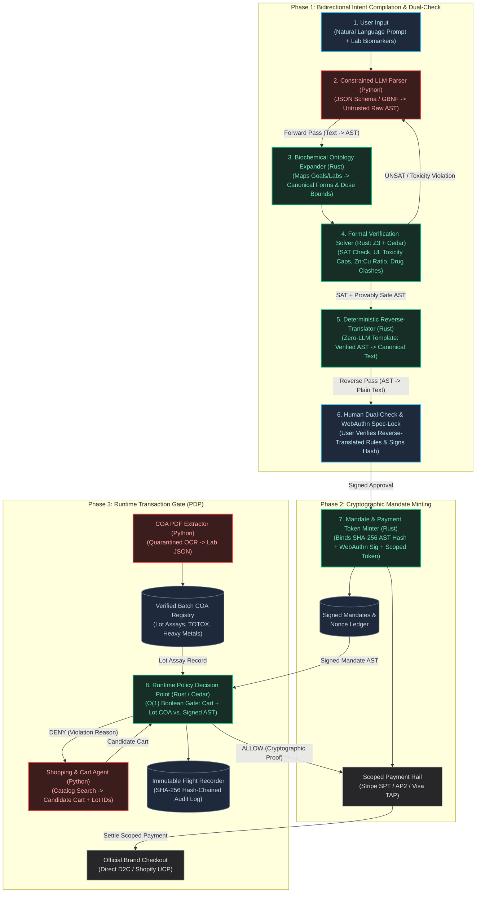

## Agentic-Commerce-Cryptography
Agentic-Commerce Cryptography sits at the intersection with different technologies like Policy Definition, Identity Verification, Token Based Spending and Liability.


# Verifiable Supplement Agentic Commerce Engine

A neuro-symbolic architecture for autonomous supplement procurement. Probabilistic LLMs handle natural-language parsing and catalog search inside a strict sandbox, while a **deterministic Rust Trust Core** compiles user intent into a formally verified policy AST, reverse-translates it for human passkey approval, and enforces sub-millisecond checkout authorization against verified batch Certificates of Analysis (COAs).

---

## 1. End-to-End System & Dual-Check Architecture



---

## 2. How the Dual-Check Pipeline Works

Because LLMs can misinterpret subtle negations or clinical thresholds during parsing, **no policy is ever executed directly from LLM output**. Instead, every policy passes a **two-way verification loop**:

```text
[Raw Prompt] ──(1. LLM Forward Parse)──► [Candidate AST] ──(2. Z3/Cedar Proof)──► [Verified AST]
                                                                                         │
[Signed Mandate] ◄──(4. Passkey Sign)── [Canonical Summary] ◄──(3. Rust Reverse-Render)──┘
```

### Step 1: Forward Pass (`Text → Typed AST` via Constrained Decoding)
The Python worker forces the LLM to emit a strictly typed JSON Abstract Syntax Tree (AST) locked to finite domain enums—never free-form code.
* **Input:** *"Get me magnesium for deep sleep and an omega-3, max €120/mo, no oxide or titanium dioxide."*
* **Untrusted Output (`RawIntentAST`):**
  ```json
  {
    "goals": ["SLEEP_QUALITY", "CARDIOVASCULAR_LIPIDS"],
    "requested_compounds": ["MAGNESIUM", "OMEGA_3_EPA_DHA"],
    "excluded_excipients": ["MAGNESIUM_OXIDE", "TITANIUM_DIOXIDE"],
    "max_monthly_budget_eur_cents": 12000
  }
  ```

### Step 2: Mathematical & Biochemical Verification (`Z3 / SMT + Cedar`)
The Rust Trust Core expands the enums using a versioned biochemical ontology and runs formal verification before any human sees the summary:
1. **Ontology Expansion:** `"MAGNESIUM"` + `"SLEEP_QUALITY"` deterministically injects `allowed_forms = ["Magnesium Bisglycinate"]`, `forbidden_forms = ["Magnesium Oxide", "Magnesium Carbonate"]`, and `daily_elemental_mg = [200.0, 400.0]`. `"OMEGA_3_EPA_DHA"` injects `molecular_form = "rTG"` and `max_totox = 10.0`.
2. **Satisfiability (SAT) & Safety Proof:** Z3 verifies that constraints do not contradict each other (e.g., impossible budget vs. clinical minimum doses) and enforces global upper-limit invariants across the entire stack:
   $$\sum \text{ElementalZinc}_i \le 40\text{ mg/day} \quad \land \quad \frac{\sum \text{Zinc}_i}{\sum \text{Copper}_i} \le 15$$
3. **Policy Schema Check:** AWS Cedar validates that the compiled policy is strictly bounded (finite expiration, explicit spend cap, `DIRECT_BRAND_OFFICIAL` channel lock).

### Step 3: Reverse Pass (`Verified AST → Deterministic Plain Language`)
To eliminate silent semantic drift between what the user *meant* and what the LLM *parsed*, a **zero-LLM Rust template engine** renders the exact verified AST back into canonical human-readable rules:

> **Verify & Sign Mandate (`sha256:9f84c1...`)**
> * **Allowed Compounds:**
>   1. **Magnesium Bisglycinate:** `200–400 mg` elemental/day *(Blocks: Magnesium Oxide, Magnesium Carbonate)*
>   2. **Omega-3 (rTG Form):** `1000–2000 mg` EPA+DHA/day *(Requires: TOTOX < 10.0)*
> * **Hard Excipient Blocks:** `titanium_dioxide`, `magnesium_stearate`
> * **Lab Verification:** Requires batch-matched **ISO-17025 COA** + passing heavy metals panel
> * **Spend & Channel Cap:** Max **`€120.00 / month`**, official D2C brand checkouts only

### Step 4: Cryptographic Spec-Lock (`WebAuthn / Passkey`)
The user visually confirms the reverse-translated rules and signs the SHA-256 hash of the canonical `MandatePolicy` AST via WebAuthn. The Rust backend mints a scoped payment token bound to that exact AST hash.

---

## 3. Core Rust Data Contracts (`crates/policy-core`)

```rust
use chrono::{DateTime, Utc};
use serde::{Deserialize, Serialize};
use uuid::Uuid;

#[derive(Debug, Clone, Serialize, Deserialize, PartialEq, Eq)]
pub enum MerchantChannel {
    DirectBrandOfficial,
    VerifiedPharmacy,
}

#[derive(Debug, Clone, Serialize, Deserialize)]
pub struct MandatePolicy {
    pub mandate_id: Uuid,
    pub user_id: Uuid,
    pub ast_sha256: String,
    pub expires_at: DateTime<Utc>,
    pub max_total_eur_cents: u64,
    pub allow_auto_reorder: bool,
    pub allowed_channels: Vec<MerchantChannel>,
    pub line_item_rules: Vec<CompoundRule>,
    pub global_invariants: GlobalSafetyInvariants,
    pub global_excluded_excipients: Vec<String>,
}

#[derive(Debug, Clone, Serialize, Deserialize)]
pub struct CompoundRule {
    pub active_ingredient: String,
    pub allowed_forms: Vec<String>,
    pub forbidden_forms: Vec<String>,
    pub daily_elemental_mg_min: f64,
    pub daily_elemental_mg_max: f64,
    pub max_totox: Option<f64>,
    pub require_iso17025_coa: bool,
}

#[derive(Debug, Clone, Serialize, Deserialize)]
pub struct GlobalSafetyInvariants {
    pub max_total_daily_zinc_mg: f64,
    pub max_zinc_to_copper_ratio: f64,
    pub max_total_daily_vitamin_d_iu: f64,
    pub active_drug_contraindications: Vec<String>,
}

#[derive(Debug, Clone, Serialize, Deserialize)]
pub struct BatchCoaRecord {
    pub sku_gtin: String,
    pub brand_slug: String,
    pub lot_number: String,
    pub iso17025_lab_accredited: bool,
    pub certificate_sha256: String,
    pub verified_at: DateTime<Utc>,
    pub active_assays: Vec<AssayMeasurement>,
    pub excipients: Vec<String>,
    pub totox_value: Option<f64>,
    pub heavy_metals_pass: bool,
}

#[derive(Debug, Clone, Serialize, Deserialize)]
pub struct AssayMeasurement {
    pub active_ingredient: String,
    pub chemical_form: String,
    pub measured_elemental_mg_per_unit: f64,
}
```

---

## 4. Runtime Cedar Gate (`policies/supplement_gate.cedar`)

At checkout settlement, the Policy Decision Point (PDP) runs an $O(1)$ deterministic check with **zero LLM involvement**:

```cedar
permit (
    principal == Agent::"SupplementProcurementAgent",
    action == Action::"SettleScopedPayment",
    resource
)
when {
    resource.mandate_signature_valid == true &&
    resource.mandate_expired == false &&
    resource.merchant_channel == "DirectBrandOfficial" &&
    resource.cart_total_eur_cents <= resource.mandate_max_eur_cents &&
    resource.all_items_have_verified_lot_coa == true &&
    resource.all_items_heavy_metals_pass == true &&
    resource.max_cart_totox < 10.0 &&
    resource.contains_forbidden_form == false &&
    resource.contains_excluded_excipient == false &&
    resource.total_daily_zinc_mg <= resource.mandate_max_zinc_mg &&
    resource.has_drug_contraindication == false
};
```

---

## 5. Monorepo Structure

```text
verifiable-supp-agent/
├── Cargo.toml                   # Rust workspace root
├── crates/
│   ├── policy-core/             # AST structs, ontology expander, Z3 solver checks, reverse-translator
│   ├── coa-registry/            # SQLx/SeaORM persistence for verified batch COAs & hash-chained audit logs
│   └── gateway-api/             # Axum server (/v1/mandates/compile, /v1/mandates/sign, /v1/checkout/authorize)
├── policies/
│   └── supplement_gate.cedar    # Declarative Cedar runtime authorization policy
├── services/
│   └── llm-worker/              # Python FastAPI service (uv): Pydantic structured parser, COA OCR, catalog agent
├── apps/
│   └── web/                     # Next.js frontend (pnpm): Prompt UI, Dual-Check Spec-Lock modal, WebAuthn signer
└── README.md
```
